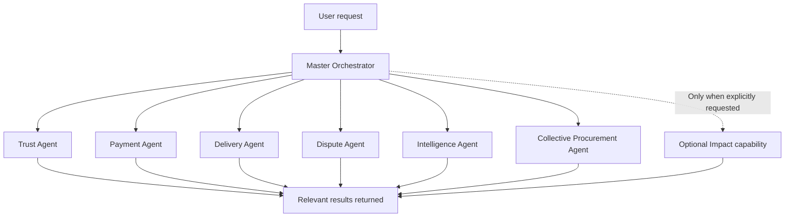

# PayPilot AI
### Six specialist agents. One coordinated commerce workflow.

> **Hackathon project · PayPal-powered prototype**
>
> PayPilot explores how a coordinated team of AI agents can make complex commerce workflows easier to understand and manage—while keeping consequential financial decisions in the hands of people.

[](https://www.paypal.com/)
[](#the-six-specialist-agents)
[](#project-status--production-readiness)

---

## The idea

Online commerce is not one task. A purchase can involve checking seller signals, initiating payment, following delivery, handling disputes and understanding business performance. Group purchasing adds another layer: collecting buyer commitments, comparing supplier offers and coordinating separate payments.

**PayPilot brings these related jobs into one AI-assisted workflow.** A master orchestrator interprets the request and delegates work to focused specialist agents. Each agent has a defined responsibility instead of relying on one general-purpose assistant to do everything.

The result is a modular commerce assistant designed around three principles:

- **Specialisation:** each agent focuses on a distinct commerce responsibility.
- **Coordination:** the orchestrator connects the right capabilities for the task.
- **Human control:** important actions—especially supplier awards and PayPal payment approval—remain explicit user decisions.

## The six specialist agents

| Agent | What it does | Why it matters |
|---|---|---|
| **1 · Trust Agent** | Summarises available seller history and risk signals. | Helps users assess a seller before proceeding. |
| **2 · Payment Agent** | Creates PayPal checkout flows and supports the payment lifecycle. | Connects the commerce experience to PayPal while preserving buyer approval. |
| **3 · Delivery Agent** | Presents shipment information and tracking evidence. | Makes order progress easier to understand. |
| **4 · Dispute Agent** | Organises transaction and delivery evidence into a draft for human review. | Helps users prepare a clearer, evidence-based dispute. |
| **5 · Intelligence Agent** | Summarises merchant order metrics and business insights. | Turns order information into more useful operational context. |
| **6 · Collective Procurement Agent** | Supports group-buy discovery, buyer commitments, supplier quote comparison, landed-cost ranking and counter-offer support. | Helps groups compare offers and coordinate a bulk purchase. |

### How the agents work together

The **Master Orchestrator is the coordinator—not a seventh specialist agent**. It interprets the user's request, selects the relevant specialists and brings their outputs together. Agents are invoked when the task calls for them; a normal purchase does not need to run every specialist.



The optional **Impact capability** is not part of the six core agents. It reports the purchase impact ledger when explicitly requested; it is not automatically run for every purchase.

## A standout workflow: Collective Procurement

Most shopping flows are designed around one buyer. PayPilot also explores a group-buy workflow where multiple buyers can combine demand, compare supplier offers and then complete their own payments.

### From a group request to individual checkout

1. **Create a campaign** — an authenticated campaign owner sets the product, target quantity, minimum quantity, currency, target price and deadline.
2. **Collect buyer commitments** — buyers specify the quantity they want and their maximum acceptable unit price.
3. **Compare supplier quotes** — suppliers submit unit price, shipping per unit, minimum quantity and lead time.
4. **Review and award** — once the minimum committed quantity is reached, the campaign owner explicitly awards a quote. The database function locks the campaign row and rechecks the conditions atomically.
5. **Checkout individually** — each committed buyer can request their own PayPal checkout. The total is calculated from quantity × (unit price + shipping per unit).
6. **Approve on PayPal** — each buyer approves their own PayPal order; the existing webhook/payment flow records payment state.

**Important design choice:** the Collective Procurement Agent provides decision support. It cannot independently award a supplier, bind a buyer or move money. The campaign owner awards the supplier, and each buyer controls their own checkout approval.

### Group-buy API

| Method | Endpoint | Purpose |
|---|---|---|
| `POST` | `/api/group-buys` | Create a campaign |
| `GET` | `/api/group-buys` | List campaigns |
| `POST` | `/api/group-buys/{campaign_id}/quotes` | Submit a supplier quote |
| `POST` | `/api/group-buys/{campaign_id}/join` | Commit to a campaign |
| `POST` | `/api/group-buys/{campaign_id}/award` | Award a supplier quote |
| `POST` | `/api/group-buys/{campaign_id}/checkout` | Start an individual buyer checkout |

For the chat agent, pass `procurement_campaign_id` to `/api/chat` and ask it to compare supplier quotes. The frontend includes an optional campaign ID field.

### Example campaign

```json
{
  "user_id": "owner_1",
  "title": "USB-C hubs bulk order",
  "product_ref": "SKU-USB-C-HUB",
  "target_quantity": 100,
  "minimum_quantity": 20,
  "currency": "USD",
  "target_unit_price": "18.00",
  "deadline": "2026-12-01T18:00:00+00:00"
}
```

A supplier quote includes `unit_price`, `shipping_per_unit`, `currency`, `lead_days` and `minimum_quantity`. A buyer commitment includes `quantity` and `max_unit_price`.

## Why this architecture?

- **One orchestrator, focused specialists:** responsibilities are separated, making the system easier to extend and reason about.
- **Task-based routing:** only relevant agents need to run for a given request.
- **Commerce-aware workflows:** the system covers more than checkout, including trust signals, delivery, disputes and merchant insights.
- **Collective purchasing:** group demand and supplier offers are represented as a persistent workflow, not just a chat response.
- **Explicit approval boundaries:** AI assistance does not equal permission to spend money or make binding procurement decisions.

## Technology

- **Frontend:** Next.js
- **Backend:** Python, FastAPI
- **Database and backend services:** Supabase
- **Payments:** PayPal integration and webhook flow
- **AI:** orchestrated specialist-agent workflow
- **Local development:** Docker support and Python development dependencies

## Run locally

### 1. Configure the backend

```bash
cp .env.example backend/.env
# Add PayPal sandbox credentials if you want to test checkout.
cd backend
python -m venv .venv
```

Activate the environment:

```powershell
# Windows PowerShell
.venv\\Scripts\\Activate.ps1
```

```bash
# macOS / Linux
source .venv/bin/activate
```

Install dependencies and start the API:

```bash
pip install -r requirements-dev.txt
uvicorn main:app --reload
```

### 2. Start the frontend

In a second terminal:

```bash
cd frontend
npm install
npm run dev
```

Open **http://localhost:3000**.

> Demo authentication is intended only for local sandbox testing. The default frontend uses a browser-generated demo user ID.

## Supabase setup

Run `backend/schema.sql` in the Supabase SQL editor. It creates the existing order tables, group-buy tables and database functions for atomic webhook claiming, buyer commitments and supplier-award checks.

Configure `SUPABASE_URL` and `SUPABASE_SERVICE_KEY` in `backend/.env`.

**Never expose the Supabase service-role key in frontend code.**

## Project status & production readiness

PayPilot is a **hackathon/sandbox prototype**, not a certified production payment platform. Do not process live money until the production requirements below have been implemented and verified in the deployment environment.

### Validation recorded for this package

- Backend Python compilation: passed.
- Backend unit tests: **19 passed**.
- FastAPI application construction: passed.
- Frontend typecheck/build: not successfully run in the recorded environment because frontend dependencies were not installed.
- Supabase SQL and live PayPal integration: not executed against external services.
- No real PayPal transaction, Supabase deployment or production security audit is claimed.

### Before any production launch

- Implement real Supabase Auth sign-in/session handling in the frontend and send verified access tokens. Backend JWT mode supports HS256 (`SUPABASE_JWT_SECRET`) and asymmetric keys via JWKS (`SUPABASE_JWKS_URL`); the JWKS path still needs verification against a real Supabase project.
- Replace the in-process IP rate limiter with a shared distributed limiter and configure trusted proxy IP handling.
- Add and verify authorization policies for supplier onboarding, campaign ownership, seller accounts and administrative actions. The backend service-role key bypasses RLS, so every endpoint must enforce identity and ownership.
- Implement campaign cancellation/expiry, quote withdrawal, commitment cancellation and refunds, partial fulfilment and failed-payment recovery.
- Add supplier identity verification and evidence-backed reliability metrics. Current quote ranking uses landed price and lead time; it does not establish supplier quality.
- Add payment reconciliation, refunds/reversals, dispute lifecycle synchronisation and operational alerts. A browser redirect must never be treated as proof of payment.
- Add distributed tracing, structured audit logs, secret rotation, backups, retention rules, monitoring and incident response.
- Verify PayPal webhook signatures and event handling in a PayPal sandbox; test duplicate, concurrent, delayed and out-of-order events.
- Run backend tests, frontend typecheck/build, API integration tests against a disposable Supabase project and a complete end-to-end sandbox purchase.

Production/live startup refuses demo auth, demo data and in-memory storage. `ENV=production` requires `DEMO_MODE=false`, `AUTH_MODE=jwt` and configured Supabase storage. `PAYPAL_MODE=live` additionally requires the webhook ID.

## Project vision

**Make commerce workflows more understandable, coordinated and accountable—with AI doing the preparation and people retaining control of consequential decisions.**

PayPilot is an exploration of how specialised AI agents can work together across the commerce lifecycle, from seller assessment and checkout to delivery, dispute preparation, merchant intelligence and collective procurement.

---

*Built as a hackathon project. Capabilities and readiness statements above reflect the repository's documented implementation and validation status.*
